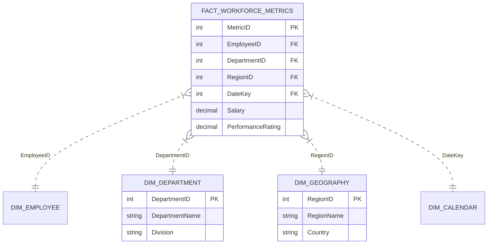

# 📊 Power BI Interactive Dashboard Fundamentals & Executive Analytics

[](https://www.coursera.org/account/accomplishments/verify/UJHZPZUHYU63)
[](https://powerbi.microsoft.com/)
[](https://learn.microsoft.com/en-us/dax/)
[](https://eng-ahmed-rifai.github.io/Power-BI-Interactive-Dashboards/)
[](LICENSE)

An executive-level Business Intelligence project implementing Microsoft Power BI core dashboard design principles, DAX calculated measures, data modeling, and interactive web visualization for workforce analytics.

---

## 👨‍💻 Author & Credential

- **Author:** **Eng. Ahmed Rifai**
- **Credential:** Coursera Guided Project Certificate: [UJHZPZUHYU63](https://www.coursera.org/account/accomplishments/verify/UJHZPZUHYU63)
- **Grade Achieved:** **100.00% Verified**
- **Date:** October 21, 2026

---

## 🌟 Key Dashboard Design Principles Applied

1. **🧱 Horizontal Tile Slicers:** Replaced vertical lists and dropdowns with top-header clickable button tiles for instant global region filtering.
2. **🧹 Clutter-Free Data Visualization:** 
   - Horizontal department bar charts ordered in **descending numerical value**.
   - Disabled the X-axis line, axis title, and redundant tick marks because in-bar data labels provide exact numbers directly to users.
3. **🎯 Executive KPI Whole Numbers:** Formatted percentage measures in the Format Pane to **0 decimal places** (e.g. `46%` instead of `46.1824%`) for crisp readability by executives.
4. **🍩 Donut Chart for Few-Category Distributions:** Utilized donut chart with center cutout for workforce gender diversity breakdowns.
5. **📈 Continuous Trend Lines:** Implemented continuous line charts for 12-month headcount trajectory tracking.

---

## 🏗️ Data Architecture & Star Schema



---

## 🧮 Core DAX Measures Library

```dax
// 1. Total Active Headcount
Total Headcount = COUNTROWS('Employees')

// 2. Retention Rate %
Retention Rate = 
DIVIDE(
    [Total Headcount] - CALCULATE(COUNTROWS('Employees'), 'Employees'[Status] = "Terminated"),
    [Total Headcount],
    1.0
)

// 3. Female Diversity Percentage (Formatted to 0 Decimals)
Diversity % = 
DIVIDE(
    CALCULATE(COUNTROWS('Employees'), 'Employees'[Gender] = "Female"),
    [Total Headcount],
    0
)

// 4. YoY Headcount Growth
YoY Headcount Growth = 
VAR PreviousYear = CALCULATE([Total Headcount], SAMEPERIODLASTYEAR('Calendar'[Date]))
RETURN
DIVIDE([Total Headcount] - PreviousYear, PreviousYear, 0)
```

---

## 🚀 Live Interactive Demo

Open the fully interactive dashboard in your browser without needing Power BI installed:
👉 **[View Live Dashboard](https://eng-ahmed-rifai.github.io/Power-BI-Interactive-Dashboards/)**

Or open `index.html` directly in any web browser.

---

## 📄 License & Attribution

Distributed under the MIT License. See `LICENSE` for more information.

*© 2026 **Eng. Ahmed Rifai** • Built with AI Agent assistance • MIT License*
